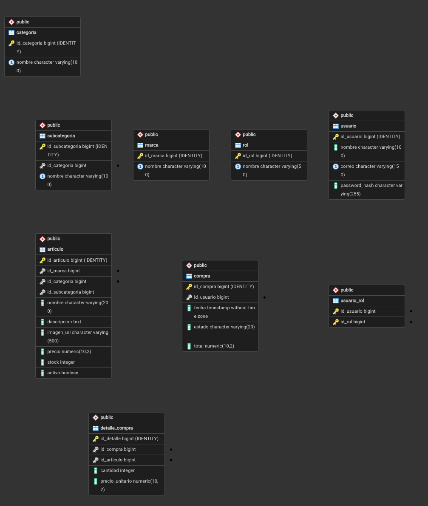

# Tienda de informática

Proyecto de portfolio: una tienda online de componentes y periféricos informáticos, inspirada en PcComponentes.

## Funcionalidades
- Catálogo de artículos con marcas, categorías y subcategorías (opcional)
- Dos tipos de usuario:
  - **Comprador**: ve el catálogo y simula compras de varios artículos
  - **Administrador**: añade artículos y crea categorías, que aparecen
    automáticamente en los menús
- Un usuario puede tener ambos roles

## Tecnologías
Java 25 · Spring Boot 4.1 · Spring Security · Hibernate/JPA · AspectJ · PostgreSQL · Maven

## Modelo de datos

