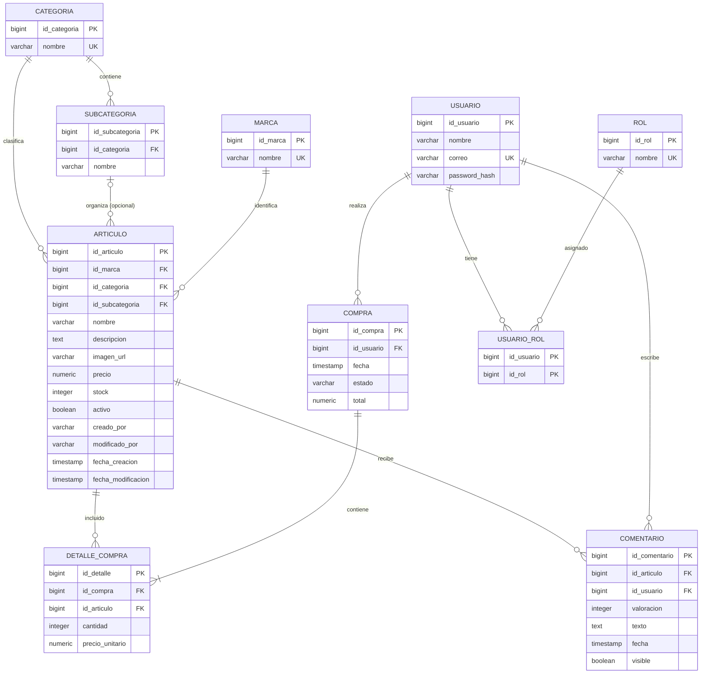
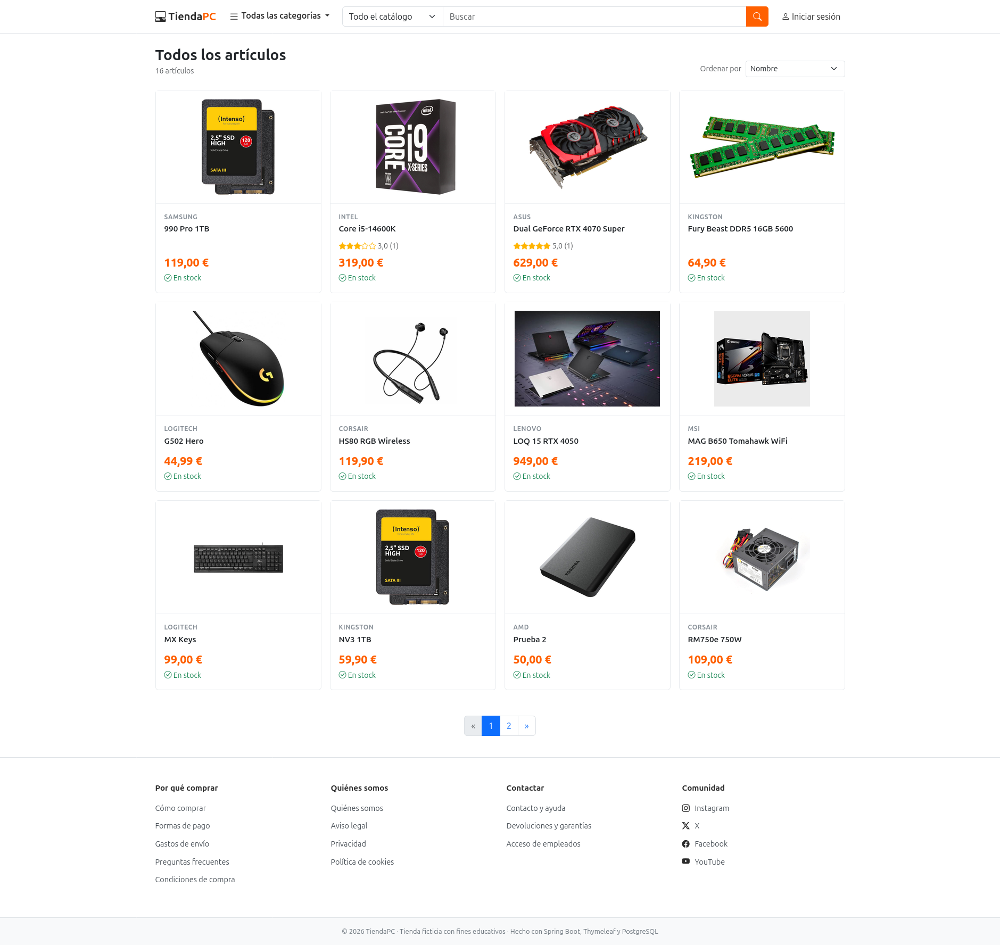
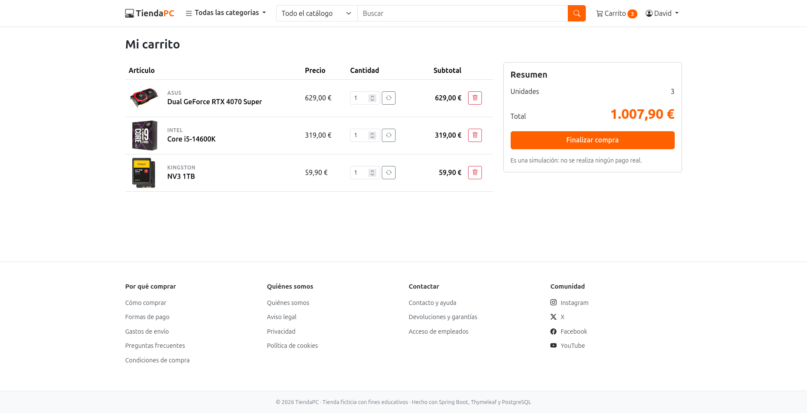

# TiendaPC · Tienda de informática

Proyecto de portfolio: una tienda online de componentes y periféricos informáticos, inspirada en PcComponentes. **Es una tienda ficticia con fines educativos**: no se realizan cobros ni envíos reales.

## Funcionalidades

**Comprador**
- Catálogo con marcas, categorías y subcategorías (opcional), con buscador, orden (nombre, precio, valoración) y paginación.
- Ficha de artículo con foto, stock, descripción, opiniones y media de estrellas.
- Comentarios con valoración de 1 a 5 estrellas, con la insignia de «compra verificada» si el autor ha comprado el artículo.
- Carrito en un panel lateral, sin salir de la página, y finalización de compra simulada.
- Historial de compras, con cancelación de las compras pagadas (el stock vuelve a los artículos).

**Administrador (empleado)**
- Alta y edición de artículos, con subida de foto; los artículos se desactivan en lugar de borrarse.
- Gestión de marcas, categorías y subcategorías: los menús de la tienda se actualizan solos.
- Moderación de comentarios (ocultar y mostrar).
- Registro de actividad: quién creó, editó o moderó cada cosa, y cuándo.

**Cuentas**
- Registro de compradores y de empleados (con un código de empleados).
- Un mismo usuario puede tener los dos roles.
- Límite de intentos fallidos de acceso.

## Tecnologías

Java 25 · Spring Boot 4.1 · Spring Security · Spring Data JPA / Hibernate · AspectJ · Thymeleaf · Bootstrap 5 · PostgreSQL · Maven · Lombok · Docker · JUnit 5 · Mockito

## Puesta en marcha con Docker

Es la forma más rápida: no necesitas instalar JDK ni PostgreSQL, solo Docker.

```bash
cp .env.example .env
```

Edita `.env` y elige tus valores:

| Variable | Para qué sirve |
|---|---|
| `DB_PASSWORD` | Contraseña de la base de datos (la eliges tú) |
| `ADMIN_CODE` | Código de empleados: lo eliges tú y lo tendrás que escribir al crear una cuenta de administrador |

```bash
docker compose up --build
```

La primera vez, Docker compila la aplicación, crea la base de datos y carga `database/schema.sql` y `database/datos-ejemplo.sql`. Después, la aplicación queda en <http://localhost:8080>.

**Primeras cuentas:** el script no incluye usuarios, porque las contraseñas se guardan cifradas. Crea un comprador en `/registro` y un administrador en `/registro-admin`, escribiendo el `ADMIN_CODE` que pusiste en `.env`.

- **Datos persistentes:** la base de datos y las fotos subidas se guardan en volúmenes de Docker (`pgdata` y `uploads`), así que sobreviven a reinicios.
- **Parar:** `docker compose down`. Para borrar también los datos y volver a empezar de cero: `docker compose down -v`.
- **Cambiar `DB_PASSWORD` después del primer arranque:** el volumen conserva la contraseña antigua, así que hay que recrearlo con `docker compose down -v`.
- **Sin catálogo de ejemplo:** comenta la línea de `datos-ejemplo.sql` en `docker-compose.yml` antes del primer arranque.
- Los scripts SQL solo se ejecutan cuando la base de datos está vacía. Si cambias `schema.sql` después, hay que recrear el volumen con `down -v`.

## Puesta en marcha sin Docker

### Requisitos
- JDK 25
- PostgreSQL
- No hace falta instalar Maven: el proyecto incluye el *wrapper* (`mvnw`).

### 1. Base de datos

Crea una base de datos vacía (con el usuario y el nombre que uses en `application.properties`; por defecto `tiendaspring` y `david`) y ejecuta los scripts:

```bash
createdb -U david tiendaspring
psql -U david -d tiendaspring -f database/schema.sql
psql -U david -d tiendaspring -f database/datos-ejemplo.sql   # opcional: catálogo de ejemplo
```

`schema.sql` crea todas las tablas e inserta los roles `COMPRADOR` y `ADMIN`, necesarios para que la aplicación funcione. La aplicación usa `ddl-auto=validate`: **no crea tablas**, solo comprueba que coinciden con el modelo.

### 2. Variables de entorno

| Variable | Para qué sirve |
|---|---|
| `DB_PASSWORD` | Contraseña del usuario de PostgreSQL |
| `ADMIN_CODE` | Código de empleados: hay que introducirlo para crear una cuenta de administrador |

```bash
export DB_PASSWORD=tu_contraseña
export ADMIN_CODE=elige_un_codigo
```

Otras propiedades opcionales (`application.properties`):

```properties
app.uploads-dir=uploads      # carpeta donde se guardan las fotos subidas
app.imagen-max=5MB           # tamaño máximo de cada foto
```

### 3. Arrancar

```bash
./mvnw spring-boot:run
```

La aplicación queda en <http://localhost:8080>.

### 4. Primeras cuentas

El script no incluye usuarios, porque las contraseñas se guardan cifradas. Créalos desde la propia aplicación:

- **Comprador:** `/registro`.
- **Administrador:** `/registro-admin`, con el valor de `ADMIN_CODE`. El enlace «Acceso de empleados» está en el pie de página.
- **Los dos roles en la misma cuenta:** registra el mismo correo en ambas pantallas, escribiendo la contraseña actual de la cuenta.

## Pruebas

Pruebas unitarias con JUnit 5 y Mockito. No necesitan base de datos ni Docker:

```bash
./mvnw test -Dtest='!ProyectoSpringApplicationTests'
```

Cubren el carrito (stock, precios, finalizar y cancelar), el límite de intentos de acceso, la validación de imágenes, las cuentas y roles, y los permisos sobre compras ajenas.

`ProyectoSpringApplicationTests` arranca toda la aplicación, por lo que necesita PostgreSQL y las variables `DB_PASSWORD` y `ADMIN_CODE`.

## Modelo de datos



La tabla `auditoria` (registro de actividad) no tiene relaciones: guarda el correo del empleado como texto para que el historial se conserve aunque se borre una cuenta.

## Decisiones de diseño

- **El carrito es una compra en estado `PENDIENTE`.** Persiste entre sesiones y reutiliza las mismas tablas. Al finalizar pasa a `PAGADA`.
- **Los precios se fijan al pagar.** En el carrito se ve el precio actual, y al finalizar se guarda en `precio_unitario`, así las compras antiguas no cambian si el precio sube.
- **El stock se descuenta al finalizar,** con bloqueo de las filas afectadas para que dos compras simultáneas no vendan más unidades de las que hay.
- **La cancelación devuelve el stock** en una sola transacción, con la compra bloqueada para que dos cancelaciones simultáneas no lo devuelvan dos veces. Solo se pueden cancelar compras pagadas y propias.
- **Subcategoría opcional con integridad garantizada:** una clave foránea compuesta `(id_categoria, id_subcategoria)` impide que un artículo tenga una subcategoría de otra categoría.
- **Los artículos no se borran, se desactivan,** para no romper compras y comentarios antiguos.
- **Auditoría en dos capas:** Spring Data JPA rellena `creado_por` y `modificado_por` en cada artículo, y un aspecto de AspectJ (`@Auditable`) guarda el historial de acciones.
- **Subida de imágenes segura:** el tipo se decide por el contenido del archivo y no por su extensión, el nombre lo genera el servidor y se rechaza SVG.
- **Límite de intentos** de acceso por cuenta, compartido entre el login y el registro.

## Estructura

```
src/main/java/es/davidrgr/proyectoSpring/
├── controllers/   Controladores web (tienda y panel de administración)
├── servicio/      Lógica de negocio: carrito, comentarios, usuarios, catálogo, imágenes
├── repositorio/   Acceso a datos (Spring Data JPA)
├── modelo/        Entidades JPA
├── dto/           Formularios y records de solo lectura para las vistas
├── seguridad/     Configuración de Spring Security, auditoría y límite de intentos
├── web/           Configuración web y datos globales de las plantillas
└── util/
src/main/resources/
├── templates/     Plantillas Thymeleaf (con fragmentos reutilizables en fragments/)
└── static/        CSS, JavaScript e imágenes
src/test/java/     Pruebas unitarias (JUnit 5 y Mockito)
database/          Scripts SQL (esquema y datos de ejemplo)
docker/            Dockerfile de la aplicación (el docker-compose.yml va en la raíz)
```

## Capturas

<!-- Añade aquí tus capturas, por ejemplo: -->
<!--  -->
<!--  -->
<!--  -->
<!--  -->
<!--  -->

## Limitaciones conocidas

- Es una simulación: no hay pasarela de pago ni gestión de envíos.
- Es un proyecto de demostración: el código de empleados (`ADMIN_CODE`) lo elige quien despliega, y con un valor débil cualquiera podría crearse una cuenta de administrador.
- El contador de intentos de acceso está en memoria: se reinicia al apagar la aplicación y no vale para varias instancias.
- Las fotos subidas se guardan en una carpeta local (`uploads/`), que no está en el repositorio.
- Solo hay pruebas unitarias: no hay pruebas de integración ni de los controladores.
